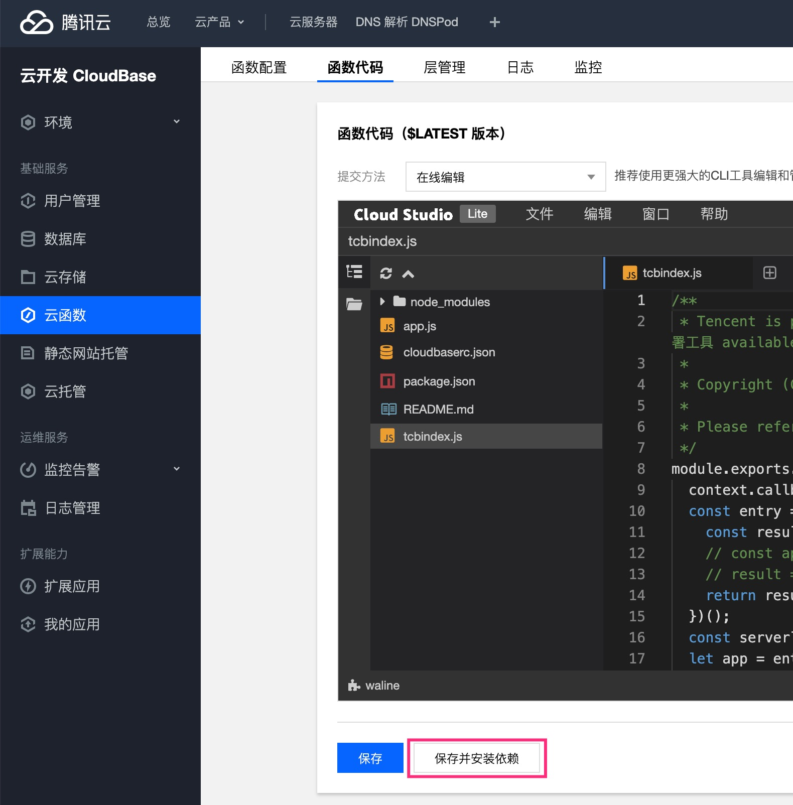

Waline a une position très claire depuis sa naissance :

::: info Un système de commentaires simple, avec backend.

:::

Toutes les versions publiées par la suite sont des modifications réalisées autour de cette position.

## Quelle est la relation avec Valine ?

::: info Waline = Valine avec backend

:::

En s'appuyant sur la version open source de Valine, la liste des commentaires côté frontend est réécrite avec React. Le style, la structure ainsi que certains outils et méthodes internes proviennent tous de Valine.

## Dois-je encore déployer Valine-Admin sur LeanCloud ?

Non. Waline réunit en un seul déploiement le stockage des données, le serveur et le client. L'interface serveur équivaut déjà au moteur cloud LeanCloud de Valine. Le serveur intègre déjà la gestion des commentaires et les notifications par e-mail fournies auparavant par le moteur cloud. Il n'a donc pas besoin du moteur cloud LeanCloud supplémentaire et n'est pas soumis à sa stratégie de mise en veille.

## Comment mettre à jour ?

Waline se compose principalement de deux parties : le frontend et le serveur.

### Frontend

Le frontend insère la liste des commentaires et la zone de commentaire en incluant un script JS dans la page web. Dans la plupart des cas, le lien utilise l'adresse de la dernière version du CDN en ligne, et la dernière version est appliquée automatiquement, sans mise à jour manuelle de la part des utilisateurs.

::: note Mise à jour manuelle nécessaire dans les cas suivants

1. Le numéro de version est explicitement fixé dans l'adresse du CDN. Dans ce cas, vous devez modifier manuellement le numéro de version pour passer à la dernière version.
1. Vous utilisez NPM pour importer et empaqueter le module dans du code. Dans ce cas, vous devez modifier le numéro de version dans la dépendance afin d'obtenir la dernière version lors de l'installation.

:::

### Serveur

Le serveur désigne le service backend correspondant au `serverURL` configuré dans le script frontend ; sa mise à jour diffère légèrement selon l'environnement de déploiement. Les mises à jour du serveur sont plus fréquentes.

#### Vercel

Rendez-vous dans le dépôt GitHub correspondant et remplacez le numéro de version de `@waline/vercel` dans le fichier package.json par la dernière version.

#### CloudBase

Accédez à la page d'édition du code et cliquez sur <kbd>Save and reinstall dependencies</kbd>. Si cela ne fonctionne toujours pas, ouvrez <kbd>My Application</kbd> et sélectionnez <kbd>Deploy</kbd> pour redéployer.

::: caution

Le redéploiement efface les fichiers précédents. Si une configuration figure dans ces fichiers, sauvegardez-la au préalable.

:::

#### Docker

Exécutez directement `docker pull lizheming/waline` pour récupérer l'image la plus récente.

## Pourquoi la publication de commentaires est-elle lente ?

Pour des raisons techniques, la détection de spam et les notifications de commentaires sont des opérations séquentielles lors de la publication d'un commentaire. La détection de spam utilise le service fourni par Akismet, à l'étranger, dont l'accès peut être lent. Les utilisateurs peuvent désactiver la détection de spam via la variable d'environnement `AKISMET_KEY=false`. Outre le service de détection de spam, la notification par e-mail peut également provoquer un délai d'attente. Vous pouvez désactiver les notifications de commentaires pour vérifier si le problème vient de cette fonctionnalité.
