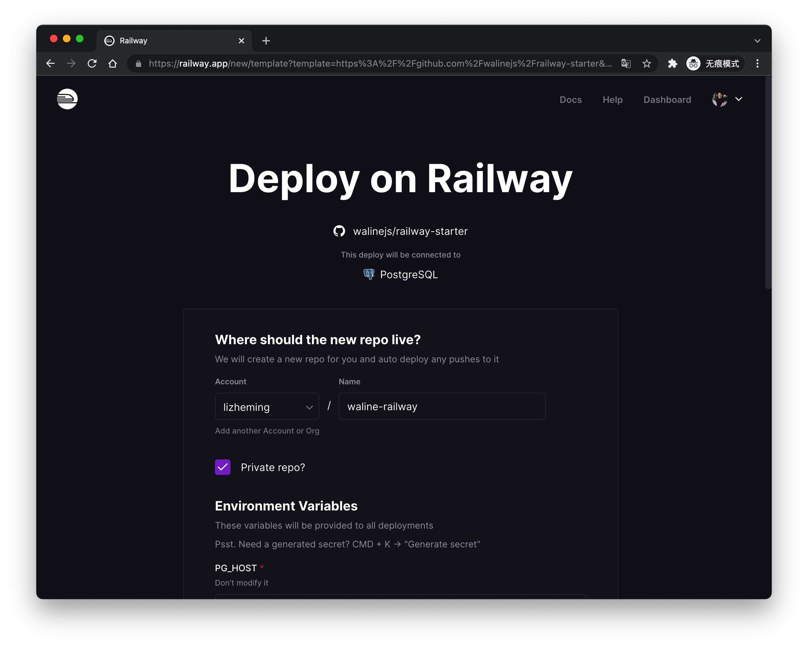
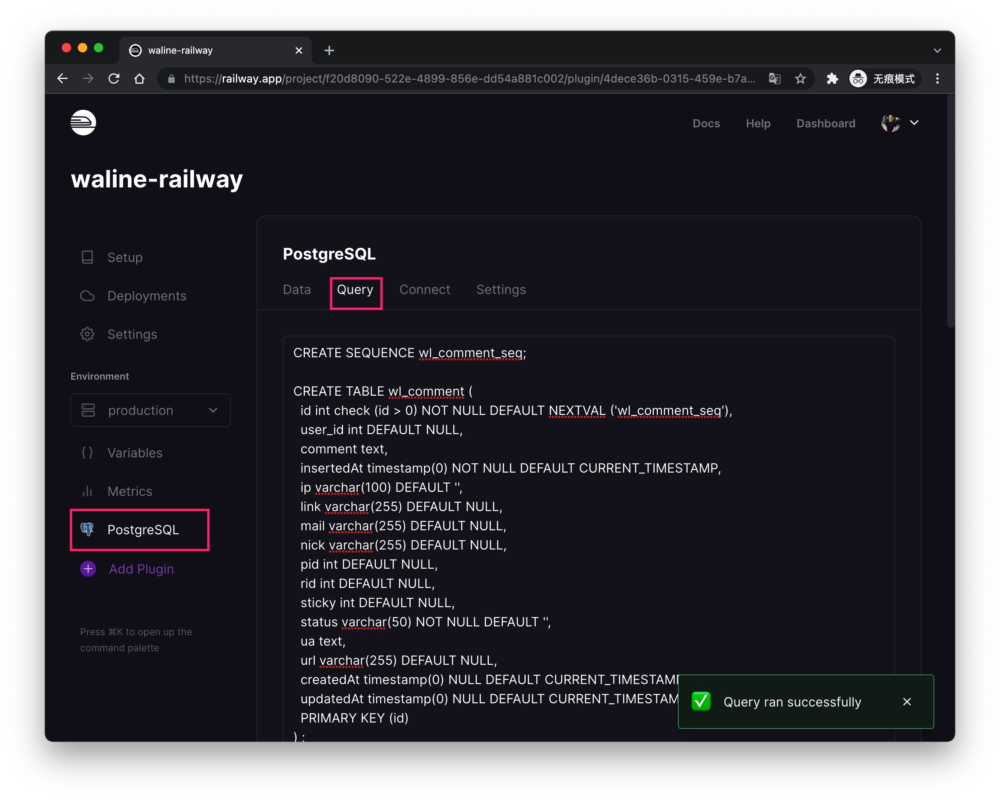
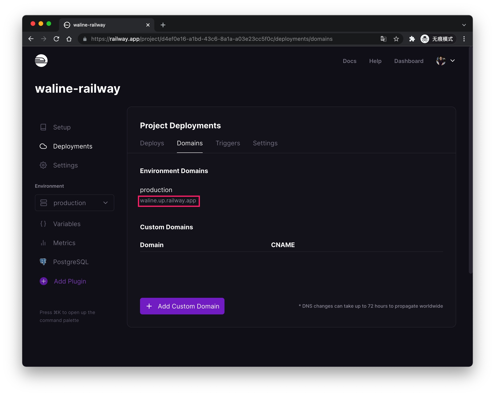
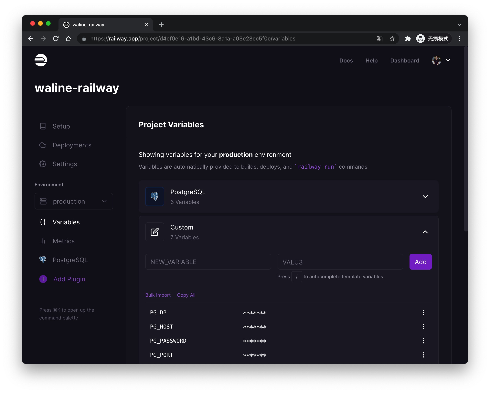

[Railway](https://railway.app/) è una piattaforma Serverless gratuita: possiamo distribuire Waline su Railway con facilità.

<!-- more -->

## Come distribuire

Fai clic su questo pulsante e verrai reindirizzato alla piattaforma railway.app per distribuire rapidamente. Dopo l'accesso puoi inserire il nome del tuo nuovo repository GitHub oppure usare quello predefinito, poi fai clic sul pulsante <kbd>Deploy</kbd> in basso per distribuire. Tieni presente che la parte relativa alle variabili d'ambiente non deve essere modificata.

Dopo qualche istante verrai reindirizzato alla pagina della dashboard. Fai clic su <kbd>PostgreSQL</kbd> - <kbd>Query</kbd> e incolla il contenuto del file [waline.pgsql](https://github.com/walinejs/waline/blob/main/assets/waline.pgsql) nell'area di testo, poi fai clic sul pulsante <kbd>Run Query</kbd> in basso per inizializzare il database.

Infine puoi fare clic su <kbd>Deployments</kbd> - <kbd>Domains</kbd> per ottenere l'URL del server. Copia l'URL del sito e inseriscilo nella configurazione `serverURL` del client. Ora puoi goderti Waline!

## Come aggiornare

Vai al repository GitHub corrispondente e modifica il numero di versione di `@waline/vercel` nel file package.json portandolo all'ultima versione.

## Come modificare le variabili d'ambiente

Fai clic sulla scheda <kbd>Variables</kbd> per accedere alla pagina di gestione delle variabili d'ambiente. Dopo la modifica delle variabili la distribuzione avverrà automaticamente.

