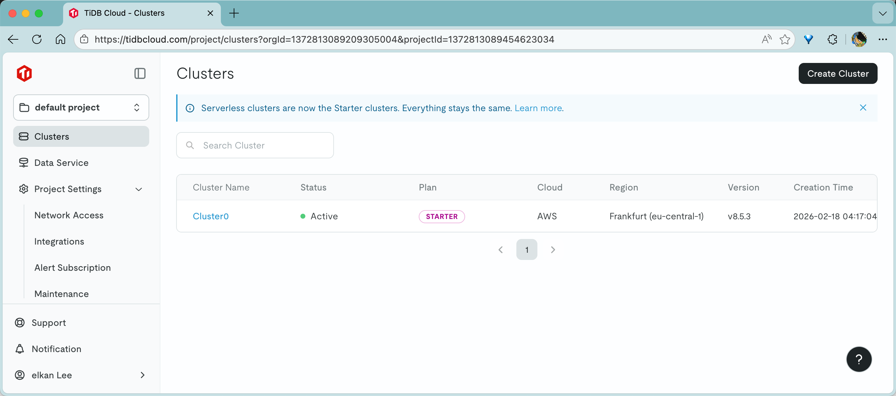
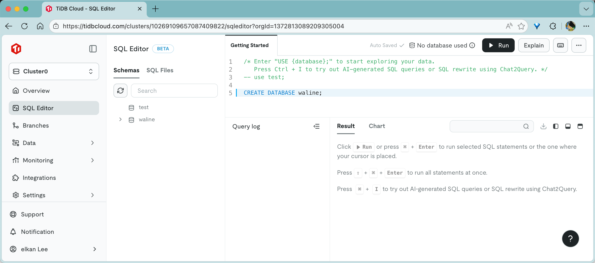
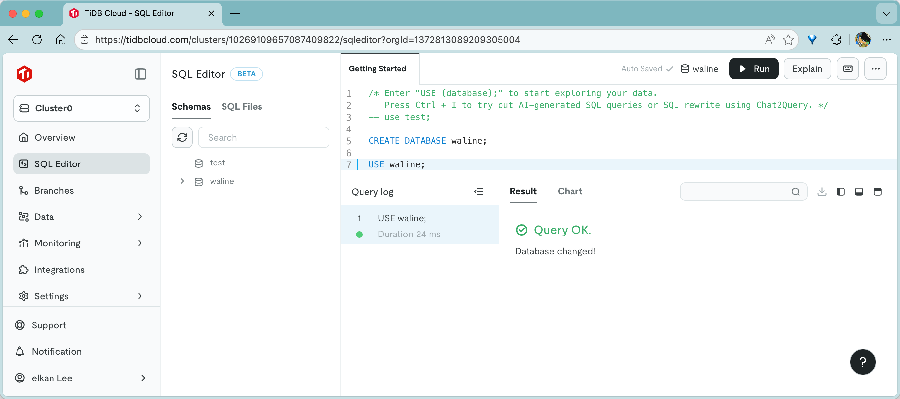
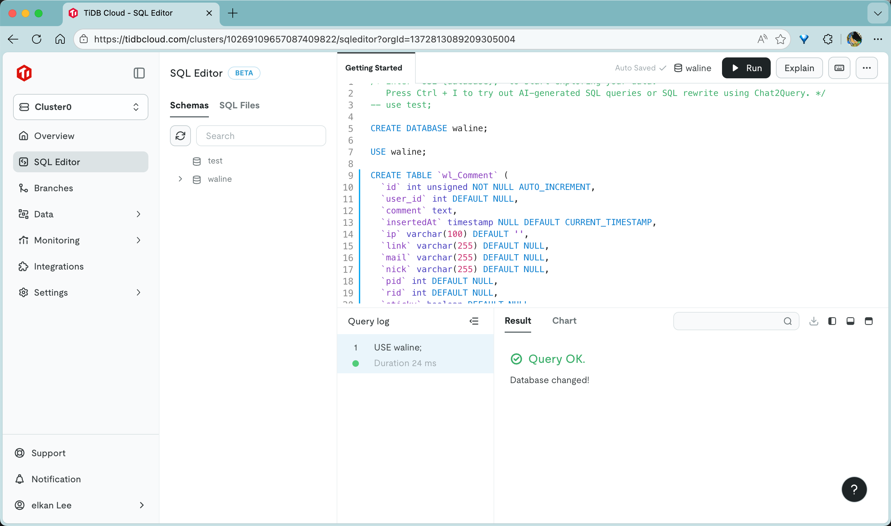
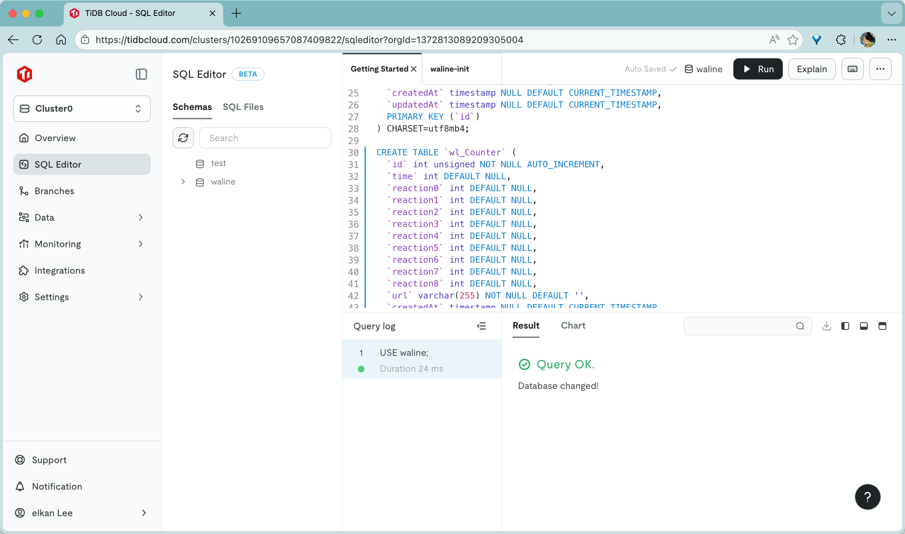
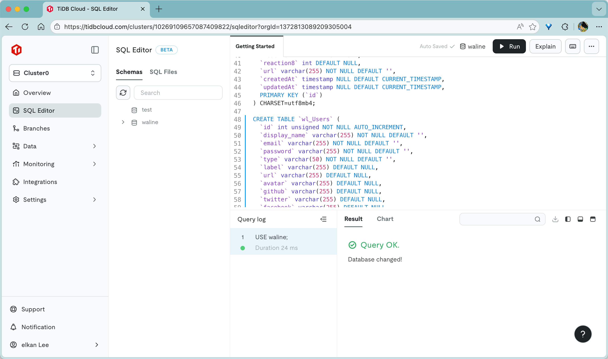
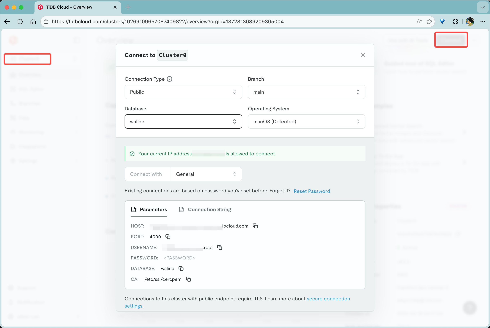
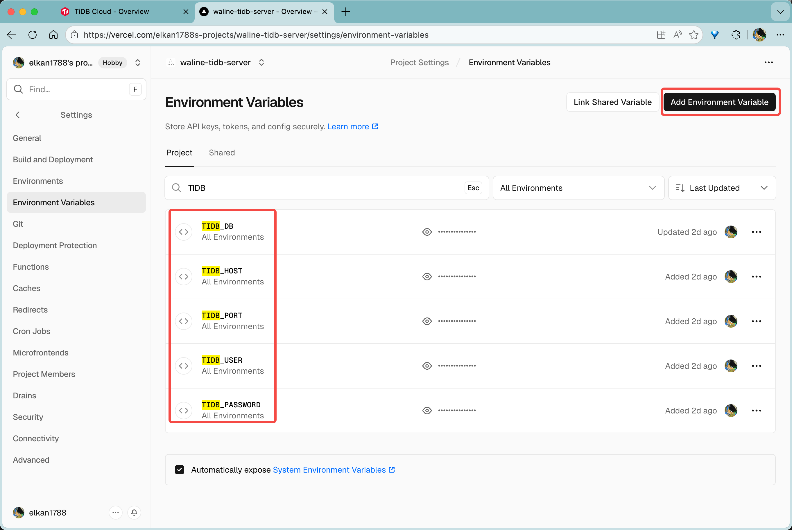

[TiDB](https://github.com/pingcap/tidb)はオープンソースのNewSQLデータベースです。[TiDB Cloud](https://tidbcloud.com/)は公式のオンラインバージョンで、誰でも利用できる5GBの無料ストレージを提供しています。以下では、TiDB Cloud上でWaline用のデータベースを作成する方法を説明します。

## データベースの作成

1. [TiDB Cloud](https://tidbcloud.com)にログインするとTiDBインスタンスが自動的に作成されるので、そのまま<kbd>cluster0</kbd>をクリックしてインスタンスに入ります

   

2. 左側の一覧で<kbd>SQL Editor</kbd>を選択し、[waline.tidb](https://github.com/walinejs/waline/blob/main/assets/waline.tidb)の内容を`;`で区切って文ごとに画面へ貼り付け、実行します。各文の実行は右上の青い<kbd>Run</kbd>ボタンをクリックするか、<kbd>Ctrl\/Command</kbd> + <kbd>Enter</kbd>のショートカットキーを利用します
   
   
   
   
   

これでWalineデータベースの作成は完了です！

## 接続設定の取得

左側の<kbd>Overview</kbd>ボタンをクリックしてホームページに入り、右上の<kbd>Connect</kbd>を選択して接続情報を取得します。

「Connect with」を`General`に設定します。あわせて、次の行の<kbd>Reset password</kbd>をクリックして新しいパスワードを生成します。

これで接続に関する設定を取得できます。

## Vercelへのデプロイ

Vercelアカウントを作成し、プロジェクトを追加してWalineサービスをデプロイします。その後、プロジェクトの<kbd>Settings</kbd>を開いて`Environment Variables`に移動します。<kbd>Add Environment Variable</kbd>をクリックし、`TIDB_HOST`、`TIDB_PORT`、`TIDB_DB`、`TIDB_USER`、`TIDB_PASSWORD`の各変数を追加します。これらの変数を追加したら、プロジェクトを再デプロイします。

