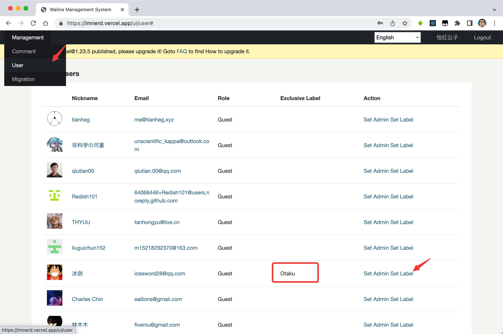
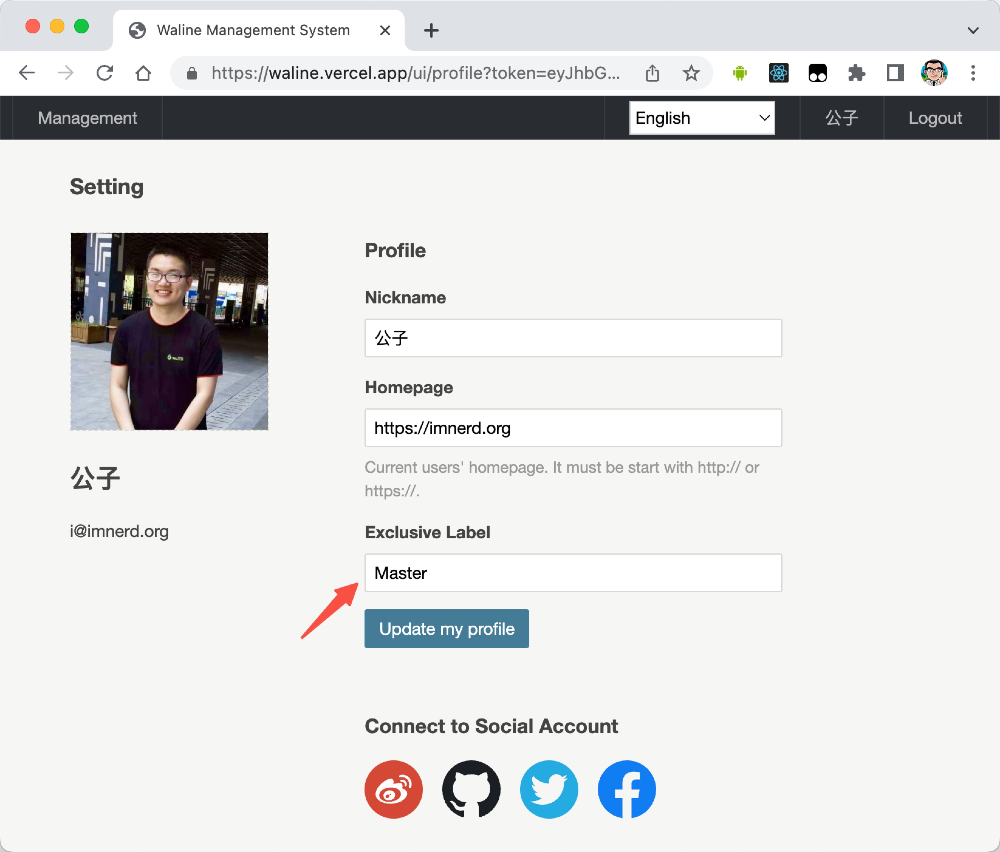

O Waline permite definir rótulos de nível com base nas interações, além de rótulos personalizados para usuários conectados.

## Rótulos de nível

Você precisa configurar a variável `LEVELS` no servidor para ativar esse recurso; veja [Configuração de variáveis de ambiente do servidor](../../reference/server/env.md#exibicao).

Você pode personalizar esses rótulos de nível com a opção locales; veja [Multilíngue](./i18n.md#personalizar)

## Rótulo exclusivo

Você pode personalizar rótulos para os usuários pelo painel administrativo.

Como usuário conectado, você também pode atualizar seu rótulo exclusivo na página de perfil.

