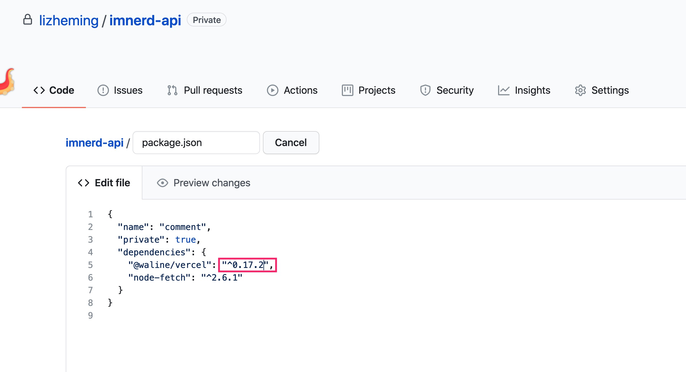

Waline с момента появления имеет очень чёткую позицию:

::: info Простая система комментариев с серверной частью.

:::

Все выпущенные позже версии создавались в рамках этой позиции.

## Какая связь с Valine?

::: info Waline = Valine с серверной частью

:::

Опираясь на открытую версию Valine, список комментариев на фронтенде переписан на React. Стиль и структура, а также некоторые внутренние инструменты и методы взяты из Valine.

## Нужно ли по-прежнему разворачивать Valine-Admin на LeanCloud?

Нет. Waline объединяет в одном развёртывании хранилище данных, сервер и клиент. Серверный интерфейс уже эквивалентен облачному движку LeanCloud из Valine. Сервер уже включает управление комментариями и уведомления по электронной почте, которые раньше предоставлял облачный движок. Дополнительный облачный движок LeanCloud не нужен, поэтому на Waline не распространяется стратегия засыпания облачного движка LeanCloud.

## Как обновиться?

Waline состоит в основном из двух частей: фронтенда и сервера.

### Фронтенд

Фронтенд вставляет список комментариев и форму комментария, подключая JS-скрипты на веб-странице. В большинстве случаев в ссылке используется адрес последней версии онлайн-CDN, и последняя версия применяется автоматически — вручную обновлять ничего не нужно.

::: note Вручную обновлять нужно в следующих случаях

1. В адресе CDN принудительно указан номер версии. В этом случае нужно вручную изменить номер версии на последний.
1. Модуль подключается через NPM и собирается в код. В этом случае нужно изменить номер версии в зависимостях, чтобы при установке была получена последняя версия зависимости.

:::

### Сервер

Сервер — это бэкенд-сервис, соответствующий `serverURL`, указанному в скрипте фронтенда; его обновление немного отличается в зависимости от среды развёртывания. Обновления сервера происходят чаще.

#### Vercel

Перейдите в соответствующий репозиторий GitHub и измените номер версии `@waline/vercel` в файле package.json на последний.

#### CloudBase

Откройте страницу редактирования кода и нажмите <kbd>Save and reinstall dependencies</kbd>. Если это не помогло, перейдите в <kbd>My Application</kbd> и выберите <kbd>Deploy</kbd>, чтобы выполнить повторное развёртывание.

::: caution

Повторное развёртывание очистит предыдущие файлы. Если в предыдущих файлах есть конфигурация, её нужно предварительно сохранить в резервную копию.

:::

#### Docker

Выполните `docker pull lizheming/waline`, чтобы скачать последний образ.

## Почему комментарии отправляются медленно?

По некоторым техническим причинам проверка на спам и уведомления о комментариях при отправке выполняются последовательно. Проверка на спам использует сервис Akismet, расположенный за рубежом, поэтому доступ к нему может быть медленным. Пользователи могут отключить проверку на спам с помощью переменной окружения `AKISMET_KEY=false`. Помимо сервиса проверки на спам, уведомление по электронной почте тоже может приводить к тайм-ауту. Можно отключить уведомления о комментариях, чтобы проверить, не из-за этой ли функции возникает задержка.
