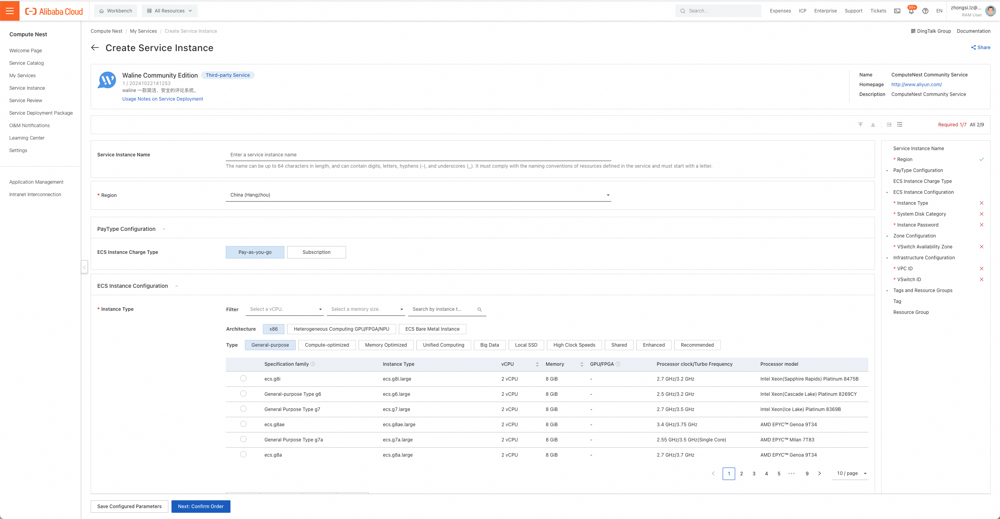
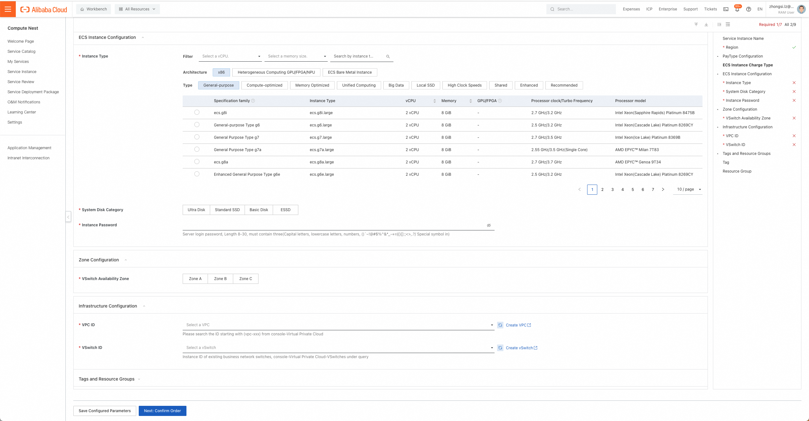
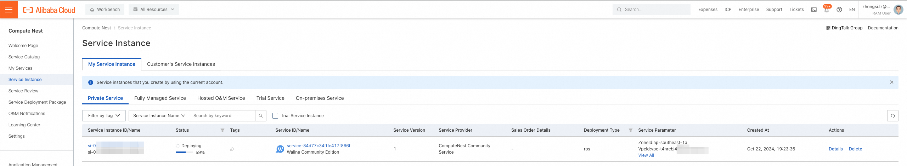
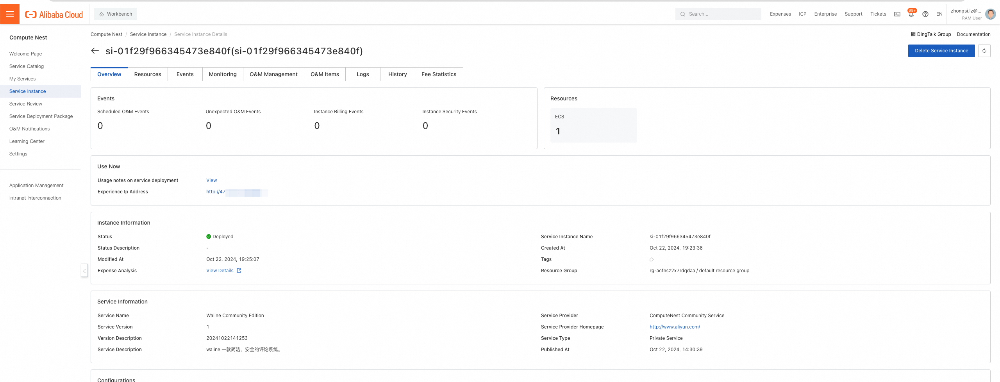

[Compute Nest](https://computenest.console.aliyun.com/) là giải pháp Nền tảng dưới dạng dịch vụ (PaaS) mà Alibaba Cloud cung cấp cho các nhà cung cấp dịch vụ và khách hàng của họ để quản lý dịch vụ.

Nhà cung cấp dịch vụ có thể công bố các dịch vụ riêng trên Compute Nest, và khách hàng của họ có thể triển khai các dịch vụ này một cách dễ dàng. Nhà cung cấp dịch vụ cũng có thể công bố các dịch vụ được quản lý hoàn toàn, qua đó họ có thể thực hiện vận hành và bảo trì (O&M) được ủy quyền cho tài nguyên của khách hàng.

Compute Nest cung cấp các năng lực dịch vụ đáp ứng từng giai đoạn trong vòng đời quản lý dịch vụ. Nhà cung cấp dịch vụ có thể quản lý các giai đoạn khác nhau bằng các mô-đun chức năng khác nhau tùy theo nhu cầu. Điều này giúp nhà cung cấp dịch vụ nâng cao hiệu quả vận hành, giảm chi phí vận hành và mang đến cho khách hàng những dịch vụ đơn giản, thuận tiện.

<!-- more -->

## Cách triển khai

1. Xác nhận trước khi triển khai: Để triển khai một phiên bản dịch vụ Waline Community Edition, bạn cần
   truy cập và tạo một số tài nguyên Alibaba Cloud. Do đó, tài khoản của bạn phải có quyền đối với các
   tài nguyên sau. Lưu ý: quyền này chỉ cần thiết khi tài khoản của bạn là tài khoản RAM.

   | Tên chính sách quyền            | Ghi chú                                                                           |
   | ------------------------------- | --------------------------------------------------------------------------------- |
   | AliyunECSFullAccess             | Quyền quản lý ECS                                                                 |
   | AliyunVPCFullAccess             | Quyền quản lý VPC                                                                 |
   | AliyunROSFullAccess             | Quyền quản lý dịch vụ điều phối tài nguyên (Resource Orchestration Service - ROS) |
   | AliyunComputeNestUserFullAccess | Quyền quản lý phía người dùng đối với dịch vụ Compute Nest                        |

1. Truy cập dịch vụ Waline trên Alibaba Compute Nest tại [Liên kết triển khai](https://computenest.console.aliyun.com/service/instance/create/default?type=user&ServiceName=Waline%20Community%20Edition), điền các tham số triển khai theo hướng dẫn
1. Chọn hình thức thanh toán, cấu hình phiên bản ECS (tức máy chủ đám mây), loại ổ đĩa hệ thống và mật khẩu phiên bản theo nhu cầu.
   
1. Chọn vùng sẵn có nơi triển khai phiên bản ECS, sau đó chọn VPC (mạng riêng) và ID vSwitch nơi phiên bản ECS đặt. Nếu tài khoản của bạn chưa có VPC và vSwitch phù hợp, bạn có thể chuyển thẳng tới bảng điều khiển của sản phẩm Alibaba Cloud tương ứng để tạo bằng cách nhấn "Create VPC" và "Create vSwitch" trong bảng điều khiển Compute Nest. Nhấn Next: Confirm Order.
   
1. Sau khi xác nhận các tham số triển khai và kiểm tra giá dự kiến, nhấn Create Now.
1. Nhấn thẻ "Service Instance" ở bên trái để vào trang danh sách phiên bản dịch vụ và xem tiến trình triển khai phiên bản dịch vụ.
   
1. Nhấn ID phiên bản, vào giao diện chi tiết, rồi nhấn "Experience Ip Address" để trải nghiệm dịch vụ Waline.
   
