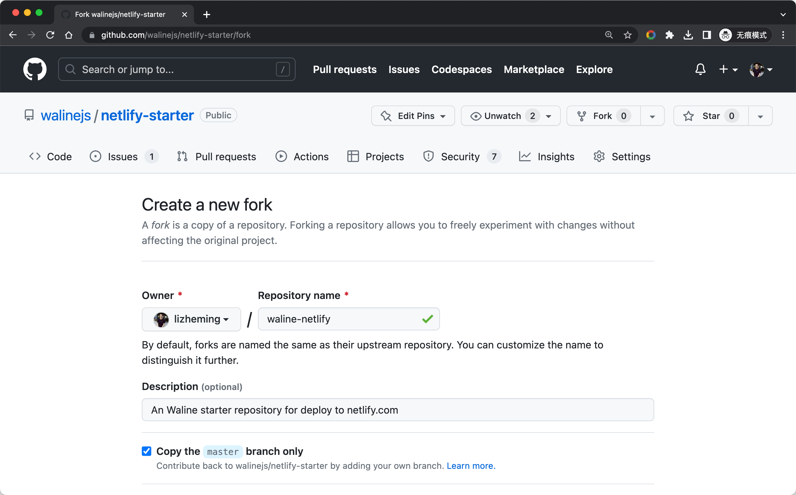
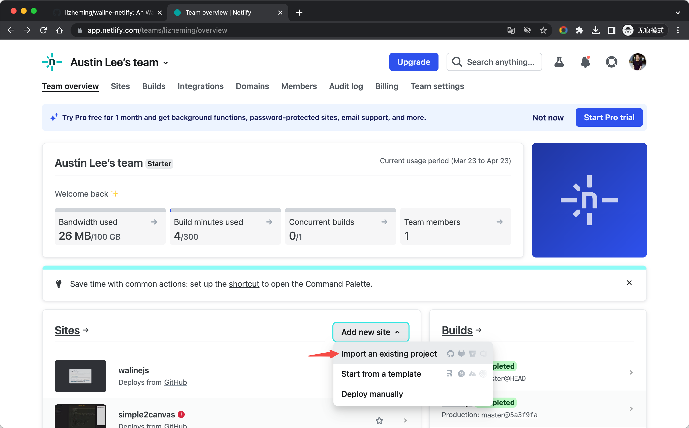
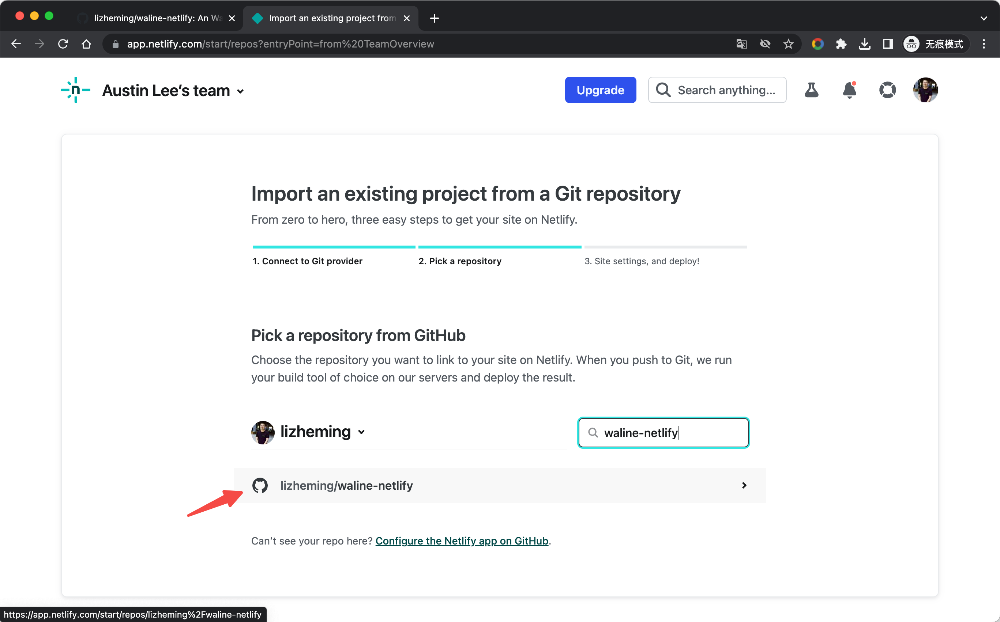
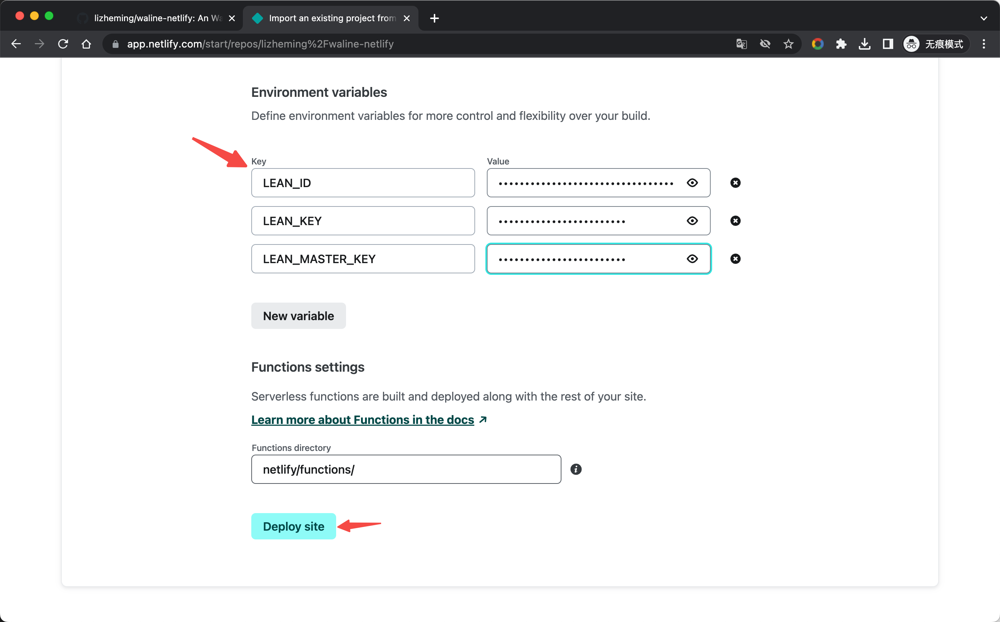
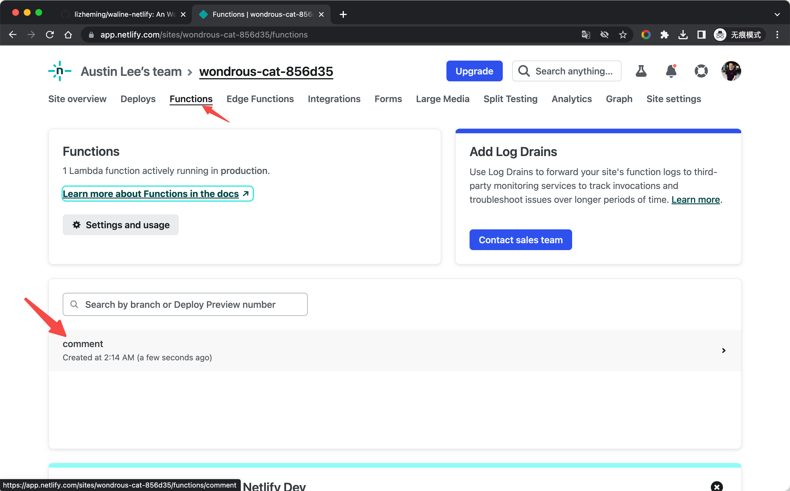
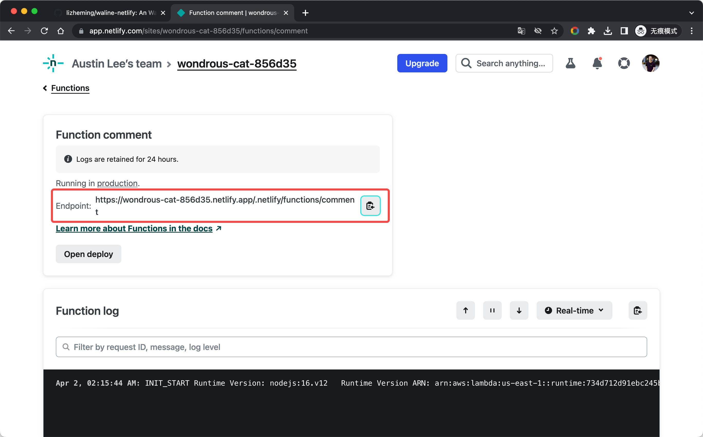
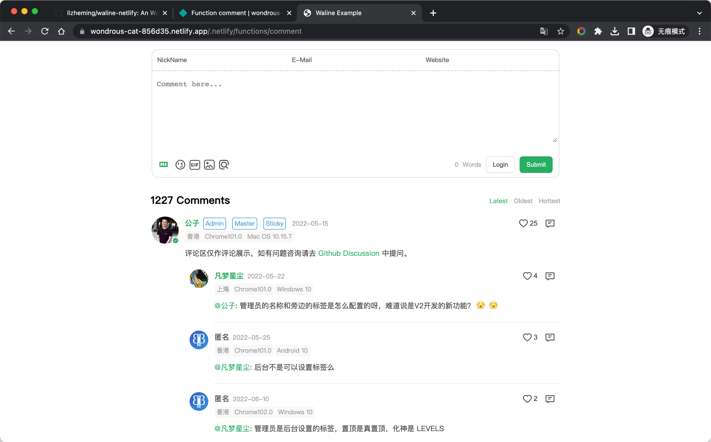
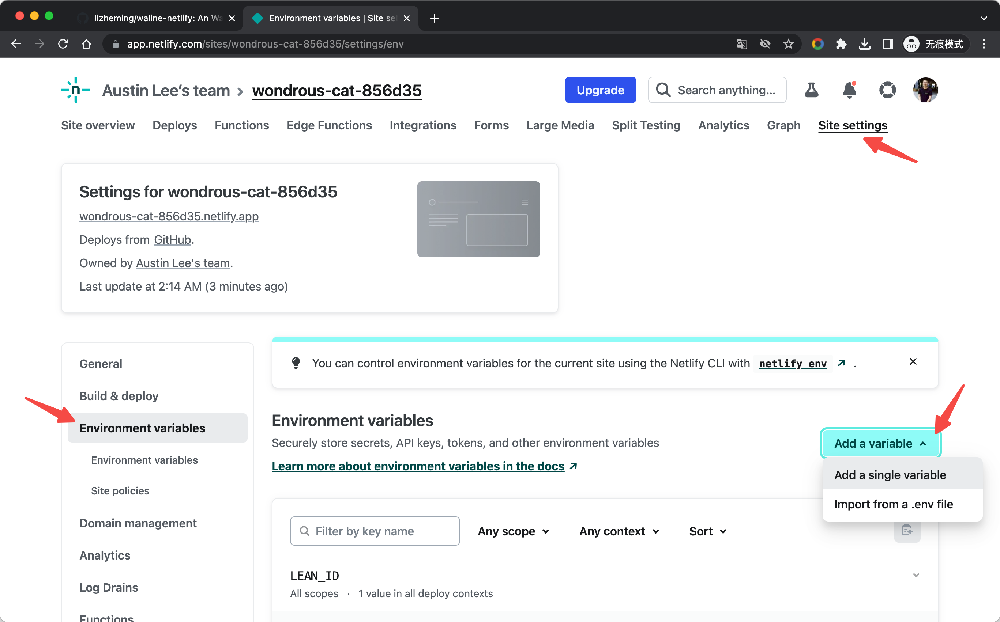
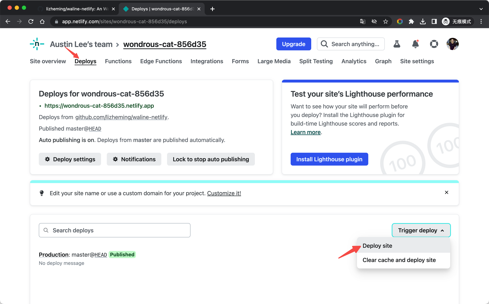

[Netlify](https://netlify.com) là nhà cung cấp dịch vụ triển khai trang web tĩnh nổi tiếng, còn [Edge Functions](https://www.netlify.com/blog/edge-functions-explained/) là một nền tảng do Netlify ra mắt, cho phép chạy mã JavaScript trên các nút biên (edge) của trang web.

<!-- more -->

## Cách triển khai

Nhấn nút [Fork](https://github.com/walinejs/netlify-starter/fork) để tạo một khung khởi đầu cho Netlify.

<https://app.netlify.com> Đăng nhập vào bảng điều khiển Netlify, chọn <kbd>Add new site</kbd> - <kbd>Import an exist project</kbd> để thêm trang. Chọn GitHub Certified để đọc danh sách dự án GitHub của chúng tôi. Tìm trong danh sách tên kho lưu trữ vừa được tạo bằng Fork, rồi nhấn vào dự án để bắt đầu tạo trang Netlify của chúng ta dựa trên kho lưu trữ này.

 

Trước khi tạo trang Netlify, chúng ta cần điền một số thông tin cấu hình. Ngoài biến môi trường, các thông tin khác có thể dùng giá trị mặc định. Tham khảo [Hỗ trợ nhiều cơ sở dữ liệu](../database.md) để thêm các biến môi trường của dịch vụ lưu trữ tương ứng, sau đó nhấn <kbd>Deploy site</kbd> ở cuối để bắt đầu triển khai trang.

Sau một lúc, trang Netlify của chúng ta được triển khai thành công. Chúng ta có thể nhấn thanh điều hướng <kbd>Functions</kbd> ở trên cùng để chuyển sang danh sách hàm đám mây, trong đó `comment` là dịch vụ Waline đã triển khai. Nhấn vào đó để vào trang chi tiết của hàm đám mây.

Trên trang chi tiết, địa chỉ được liệt kê trong `Endpoint` chính là địa chỉ triển khai dịch vụ Waline của chúng ta. Nhấn nút sao chép bên phải, mở trong thẻ mới, thử đăng bình luận, và mọi thứ đều thành công~ Tiếp theo, hãy cấu hình tên miền này trong ứng dụng khách và bạn có thể bình luận thoải mái!

 

## Cách cập nhật

Vào kho lưu trữ GitHub và sửa số phiên bản của `@waline/vercel` trong tệp package.json thành phiên bản mới nhất.

## Cách sửa biến môi trường

Nhấn thanh điều hướng `Site settings` ở trên cùng, chọn thanh bên `Environments variables` để vào trang quản lý biến môi trường. Nhấn nút `Add a variable` để thêm biến môi trường.

Sau khi chỉnh sửa biến môi trường, chúng ta cần vào trang `Deploys`, chọn `Trigger deploy` - `Deploy site` để triển khai lại trang và làm cho biến môi trường có hiệu lực.

 
