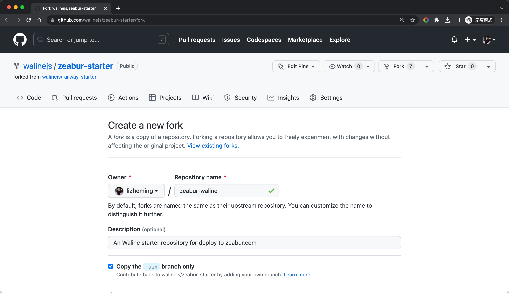
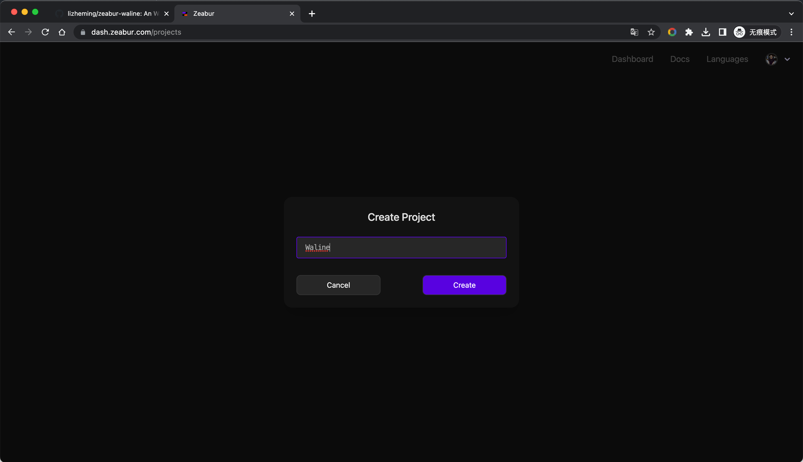
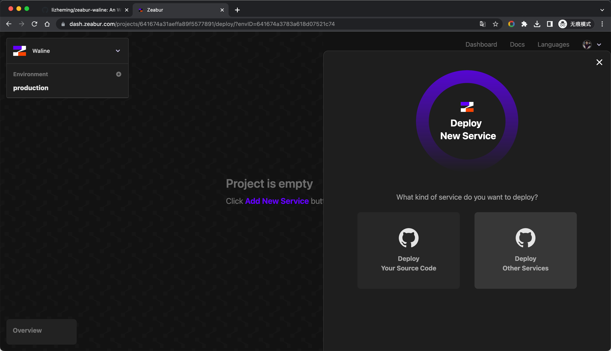
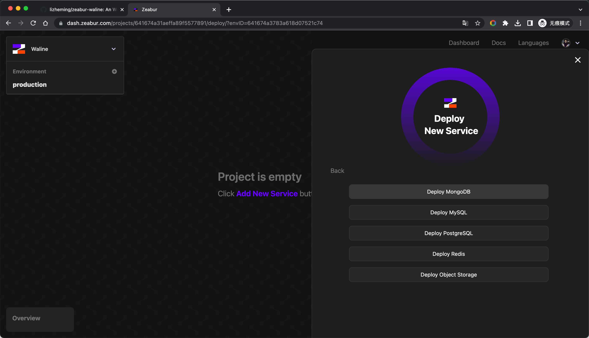
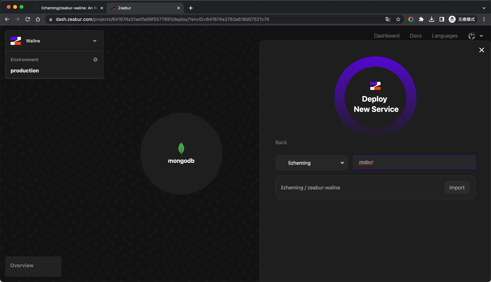
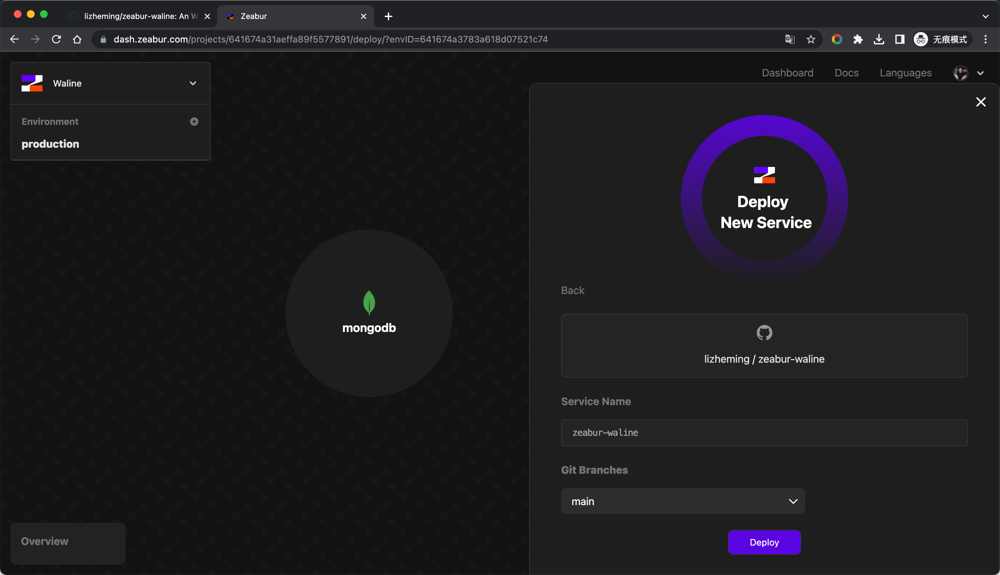
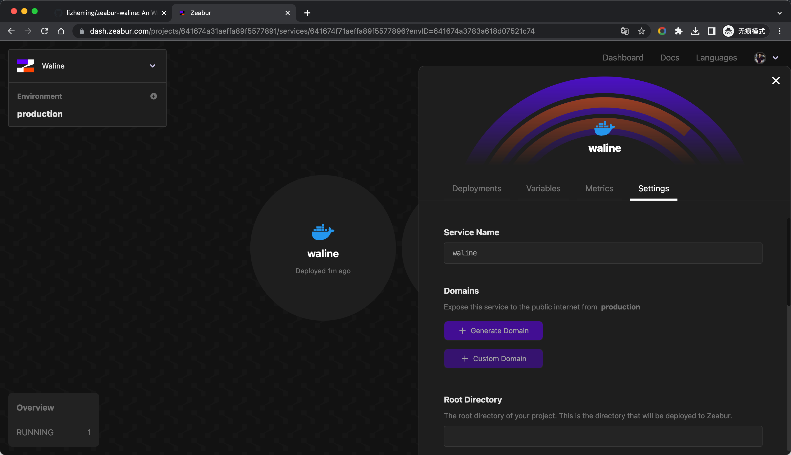
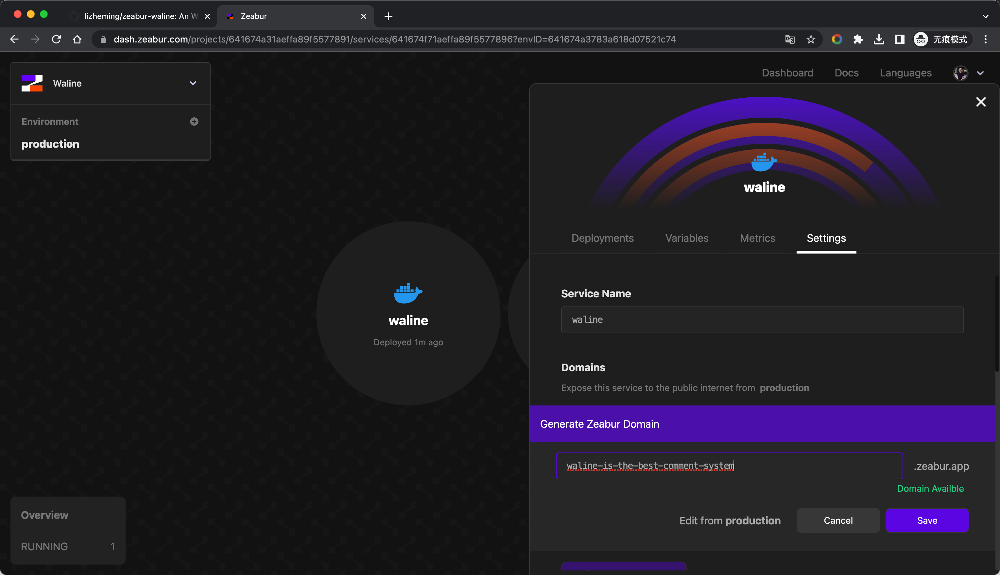
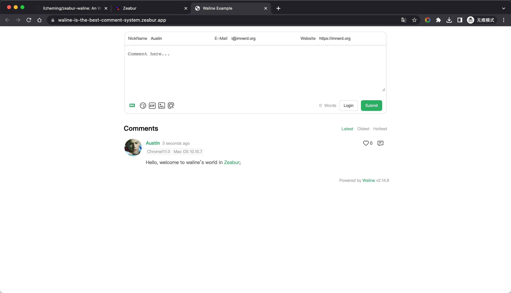
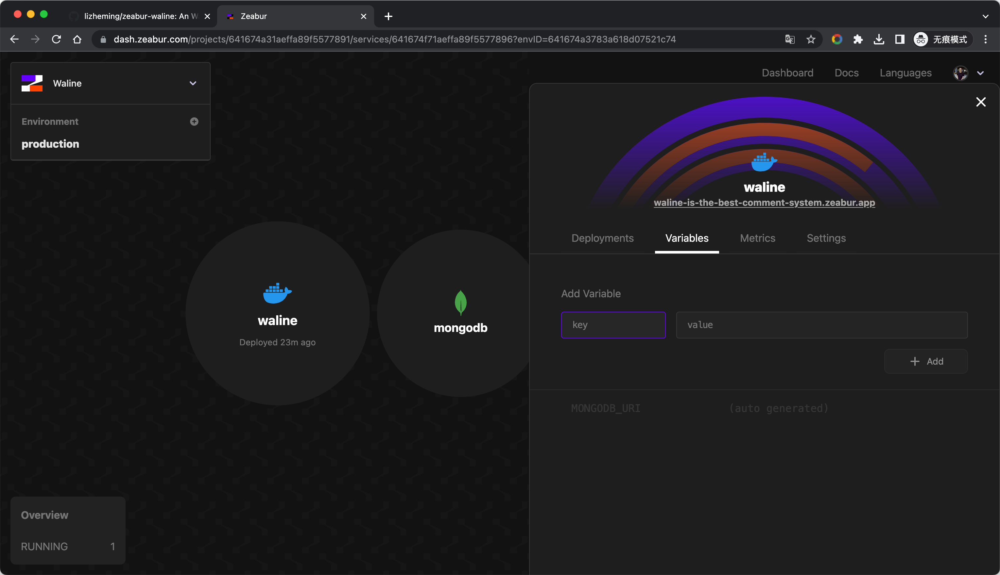

[Zeabur](https://zeabur.com) là một nền tảng giúp nhà phát triển triển khai dịch vụ của mình chỉ với một cú nhấp. Nhìn chung nó tương tự Railway nhưng có nhiều chức năng hơn, không cần liên kết thẻ tín dụng và hạn mức miễn phí cao hơn.

<!-- more -->

## Triển khai chỉ với một cú nhấp

## Triển khai từ đầu

Nhấn nút [Fork](https://github.com/walinejs/zeabur-starter/fork) để tạo một khung khởi đầu cho Zeabur.

<https://dash.zeabur.com> Đăng nhập vào bảng điều khiển Zeabur. Nếu chưa có dự án, bạn cần đặt tên cho dự án mới trước.

Sau khi vào, nhấn <kbd>Add New Service</kbd> để tạo dịch vụ, chọn <kbd>Deploy Other Service</kbd> - <kbd>Deploy MongoDB</kbd> để tạo dịch vụ cơ sở dữ liệu trước.

Đặt tên cho dịch vụ cơ sở dữ liệu MongoDB của chúng ta, nhấn nút <kbd>Deploy</kbd>, và dịch vụ cơ sở dữ liệu đã được triển khai.

 

Tiếp theo, chúng ta tiếp tục nhấn <kbd>Add New Service</kbd> để tạo dịch vụ Waline, lần này chọn <kbd>Deploy Your Source Code</kbd>. Trong danh sách dự án GitHub sau đó, tìm dự án mà chúng ta đã fork lúc đầu và nhấn nút <kbd>Import</kbd> tương ứng.

Đặt tên cho dịch vụ Waline của chúng ta, nhấn nút <kbd>Deploy</kbd>, và dịch vụ Waline đã được triển khai.

 

Đừng vội đóng bảng dịch vụ Waline. Sau khi dịch vụ được triển khai, chúng ta cần thêm tên miền truy cập cho dịch vụ. Nhấn nút <kbd>Generate Domain</kbd> trong thẻ <kbd>Domains</kbd>, nhập tiền tố tên miền bạn muốn và nhấn nút <kbd>Save</kbd> để thêm tên miền truy cập cho dịch vụ của chúng ta.

 

Mọi thứ đã sẵn sàng, bước tiếp theo là chứng kiến điều kỳ diệu. Mở tên miền truy cập chúng ta vừa thiết lập, thử đăng bình luận, và mọi thứ đều thành công~ Tiếp theo, hãy cấu hình tên miền này trong ứng dụng khách và bạn có thể bình luận thoải mái!

## Cách cập nhật

Vào kho lưu trữ GitHub và sửa số phiên bản của `@waline/vercel` trong tệp package.json thành phiên bản mới nhất.

## Cách sửa biến môi trường

Bạn có thể vào trang quản lý biến môi trường qua thẻ <kbd>Variables</kbd>, và hệ thống sẽ tự động triển khai lại sau khi sửa.

