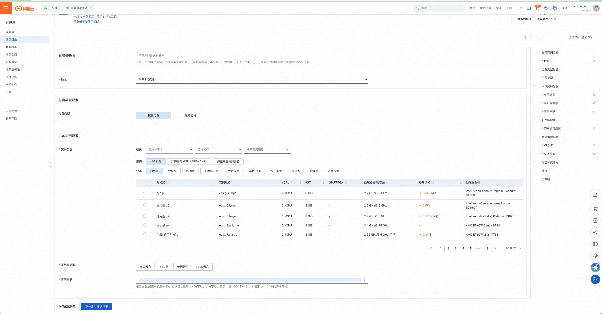
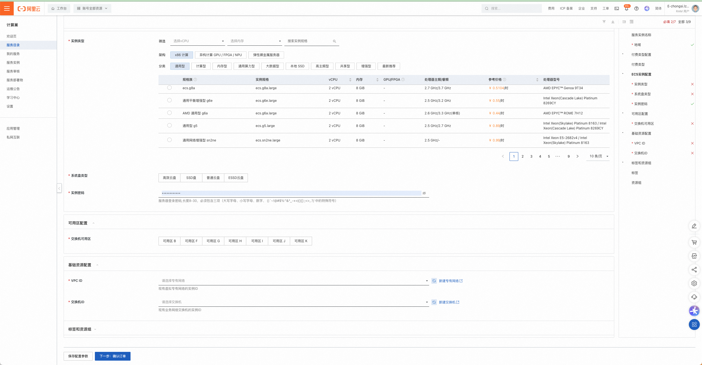
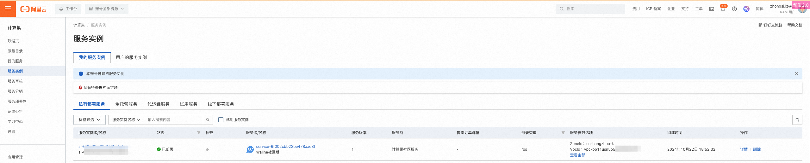
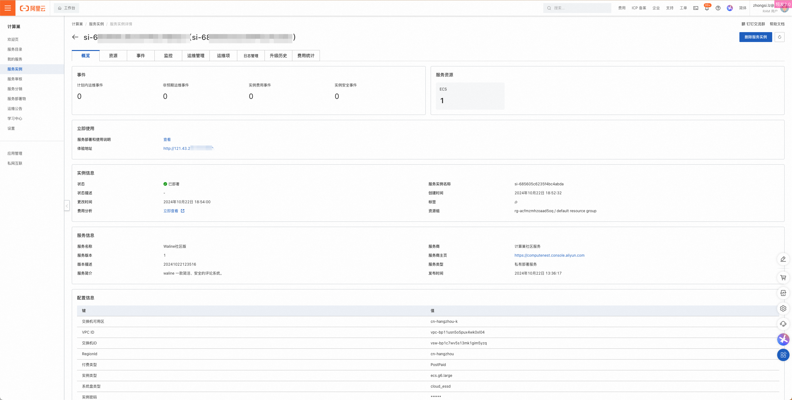

[阿里雲計算巢](https://computenest.console.aliyun.com/) 服務是一個開放給服務商（包括：企業應用服務商、IT 整合服務商、交付服務商和管理服務提供商等）與使用者的服務管理 PaaS 平台。計算巢服務為服務商與使用者提供高效、便捷、安全的服務使用體驗，服務商能更妥善地在阿里雲上部署、交付和管理服務，使用者則能集中管理在阿里雲上訂閱的各類服務商所提供的服務。

<!-- more -->

## 如何部署

1. 部署前確認：部署 Waline 服務執行個體，需要對部分阿里雲資源進行存取與建立操作。因此您的帳號需要包含下列資源的權限。 說明：只有當您的帳號是 RAM 帳號時，才需要新增此權限。

   | 權限策略名稱                    | 備註                                        |
   | ------------------------------- | ------------------------------------------- |
   | AliyunECSFullAccess             | 管理雲端伺服器服務（ECS）的權限             |
   | AliyunVPCFullAccess             | 管理專有網路（VPC）的權限                   |
   | AliyunROSFullAccess             | 管理資源編排服務（ROS）的權限               |
   | AliyunComputeNestUserFullAccess | 管理計算巢服務（ComputeNest）的使用者端權限 |

1. 造訪計算巢 Waline 服務[部署連結](https://computenest.console.aliyun.com/service/instance/create/default?type=user&ServiceName=Waline社区版)，依提示填寫部署參數
1. 依需求選擇付費類型、ECS（即雲端伺服器）執行個體規格、系統磁碟類型、執行個體密碼。
   
1. 選擇部署 ECS 執行個體的可用區，並選擇 ECS 執行個體所在的 VPC（即專有網路）與交換器 ID。如果您的帳戶下沒有可用的 VPC 與交換器，您可在計算巢控制台「新建專有網路」與「新建交換器」，直接跳轉到相關阿里雲產品控制台進行建立。同時點選下一步。
   
1. 確認部署參數並查看預估價格後，點選立即建立。
1. 點選左側 TAB「服務執行個體」，進入服務清單頁即可查看服務執行個體部署進度。
1. 點選執行個體 ID 進入詳情介面，點選「體驗位址」即可體驗 Waline 服務。
