歡迎使用 Waline，只需幾個步驟，你就可以在你的網站中啟用 Waline 提供的留言與瀏覽量服務。

<!-- more -->

## 部署伺服器

[](https://vercel.com/new/clone?repository-url=https%3A%2F%2Fgithub.com%2Fwalinejs%2Fwaline%2Ftree%2Fmain%2Fexample)

1. 點選上方按鈕，跳轉至 Vercel 進行 Server 端部署。

   ::: note

   如果你未登入的話，Vercel 會讓你註冊或登入，請使用 GitHub 帳號進行快速登入。

   :::

1. 輸入一個你喜歡的 Vercel 專案名稱並點選 `Create` 繼續：

   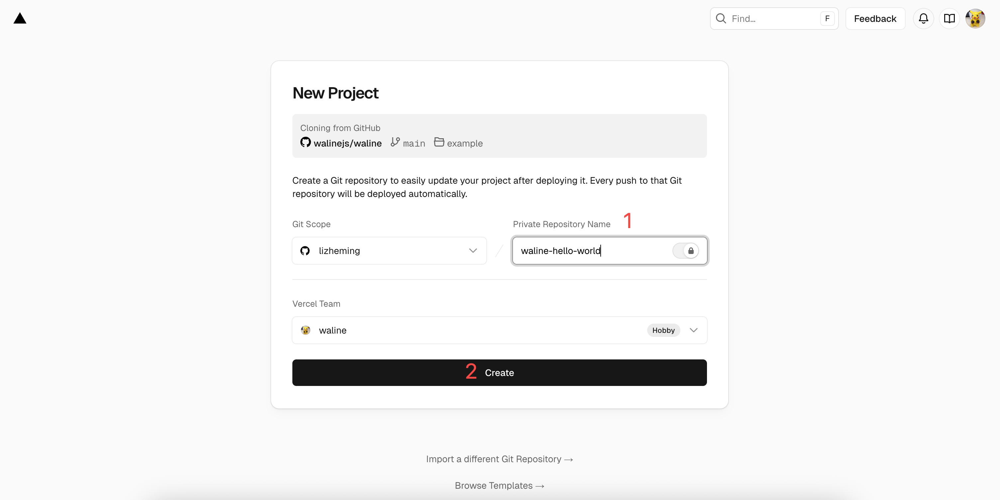

1. 此時 Vercel 會基於 Waline 範本協助你建立並初始化儲存庫，儲存庫名稱為你之前輸入的專案名稱。

   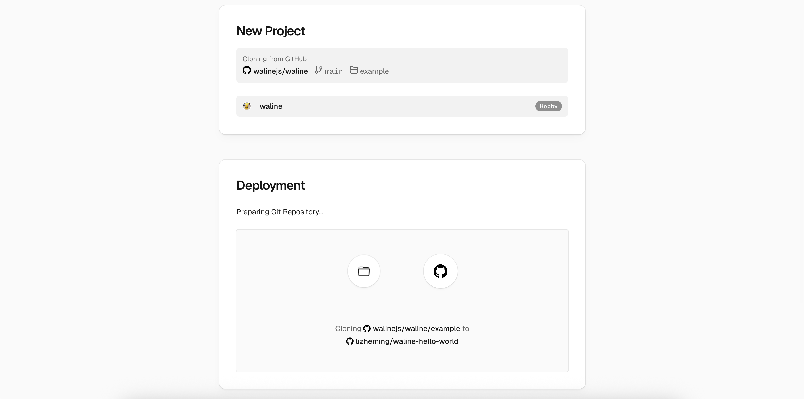

   一兩分鐘後，滿螢幕的煙火會慶祝你的部署成功。此時點選 `Go to Dashboard` 可以跳轉到應用程式的控制台。

   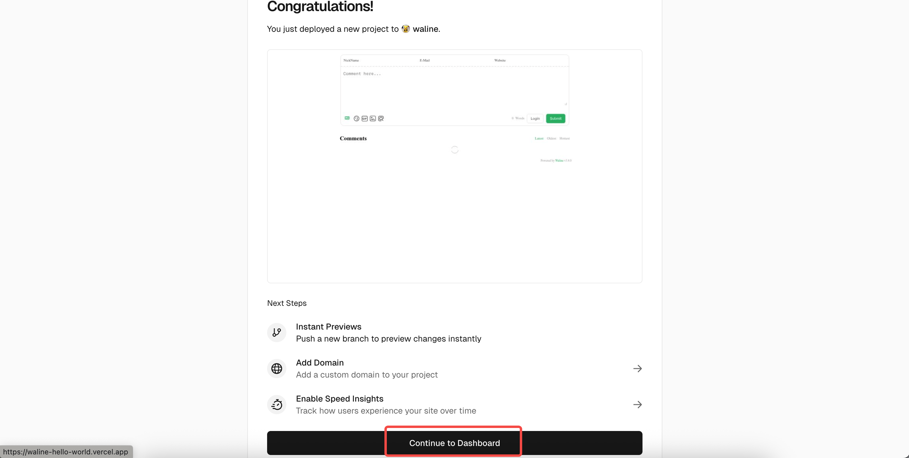

   ::: note
   這一步有可能會出現 `500 This Serverless Function has crashed` 錯誤，這個問題是因為沒有連線 Neon 資料庫所導致，一般完成下面的步驟之後就會自動恢復。
   :::

## 建立資料庫

1. 點選左側的 `Storage` 進入儲存服務設定頁，選擇 `Create Database` 建立資料庫。在 `Marketplace Database Providers` 中選擇資料庫服務 `Neon`，點選 `Continue` 進行下一步。
   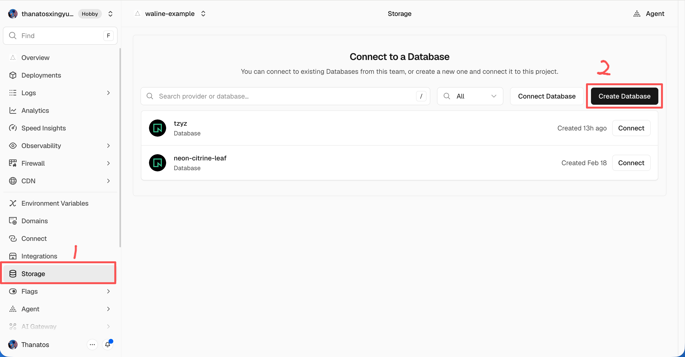
   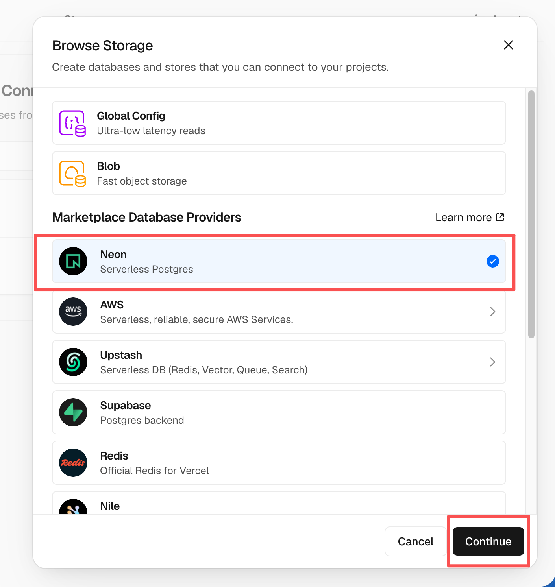

1. 此時會讓你建立一個 Neon 帳號，請選擇 `Accept and Create` 接受並建立。後續選擇資料庫的方案設定，包括地區和額度。這裡可以保持預設設定，直接向下滑動後選擇 `Continue` 進行下一步。

   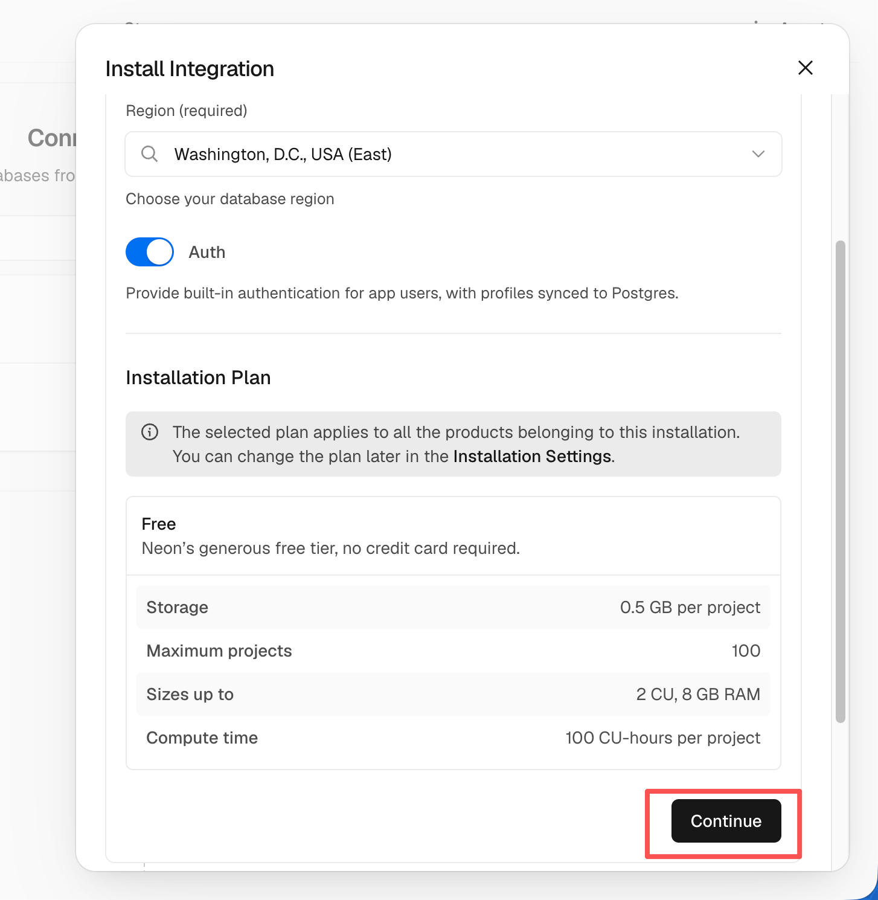

1. 此時會讓你定義資料庫名稱，這裡也可以不修改，直接點選 `Create` 進行建立。

   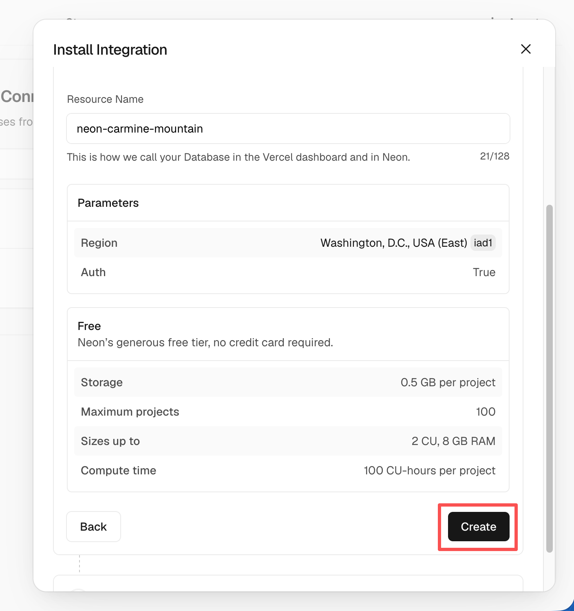

1. 這時候 `Storage` 下就有你建立的資料庫服務了。先點選 `Connect` 連線到專案，然後點選 `Connect Project` 確認。

   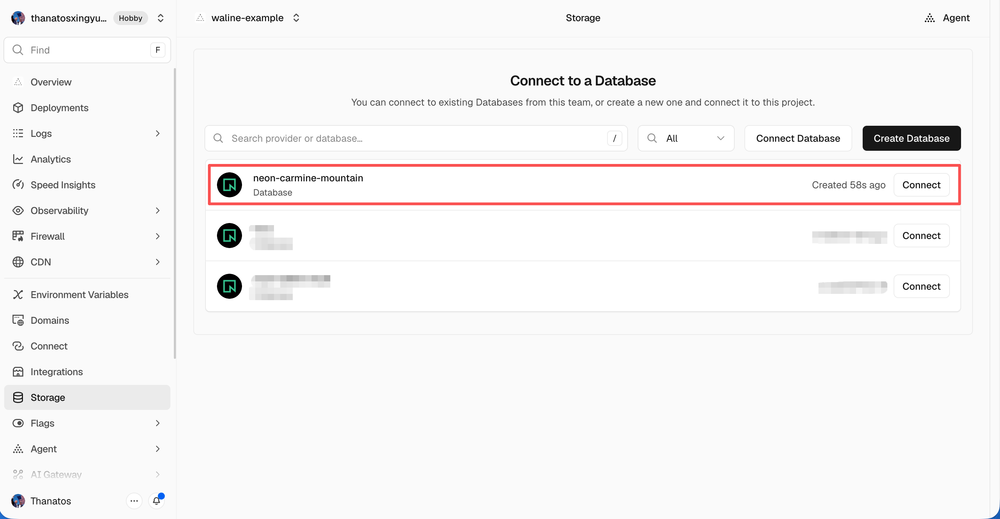
   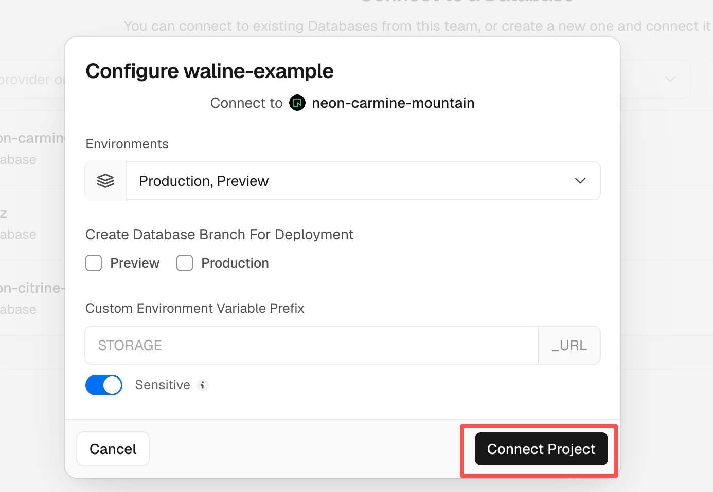

1. 等待頁面載入完畢後，在資料庫詳情頁選擇 `Open in Neon` 跳轉到 Neon。在 Neon 介面左側選擇 `SQL Editor`，將 [waline.pgsql](https://github.com/walinejs/waline/blob/main/assets/waline.pgsql) 中的 SQL 敘述貼進編輯器中，點選 `Run` 執行建立資料表操作。

   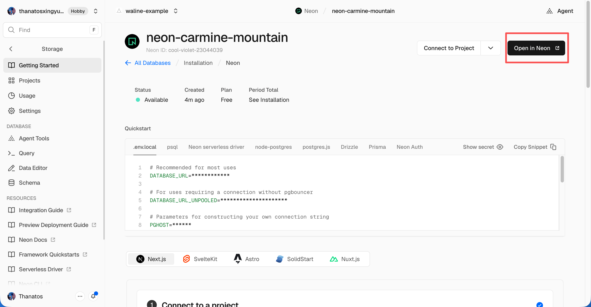

   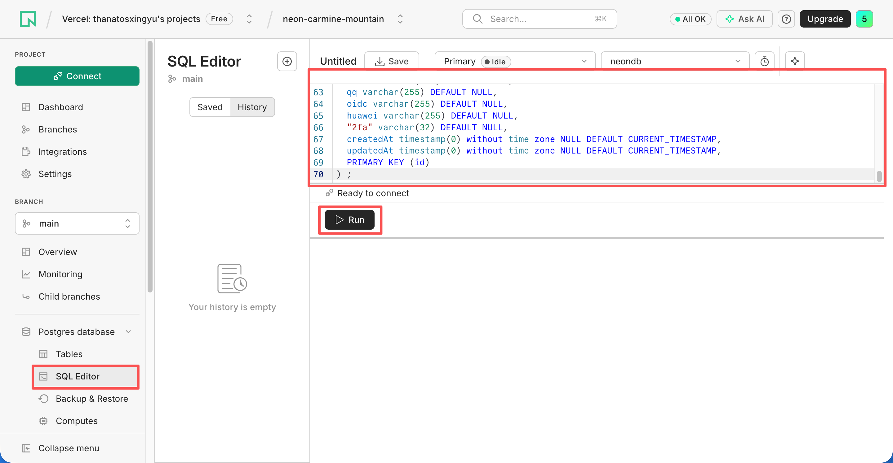

1. 等待 SQL 指令執行完畢。此時回到 Vercel，點選左側的 `Deployments`，然後選擇最上面最新的一次部署。再點選右側的 `Redeploy` 按鈕進行重新部署。該步驟是為了讓剛才設定的資料庫服務生效。

   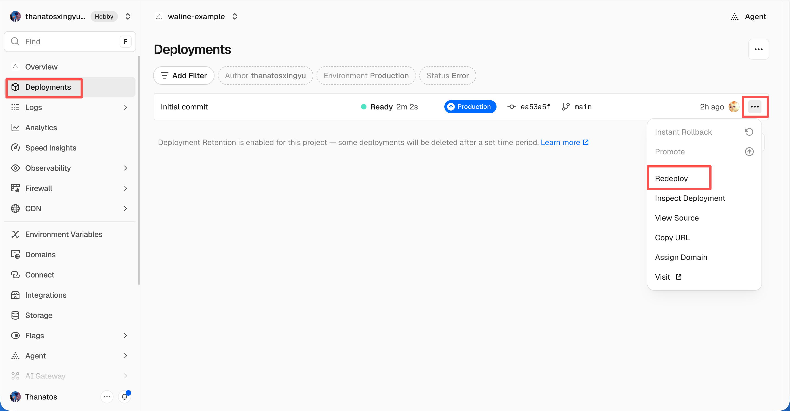
   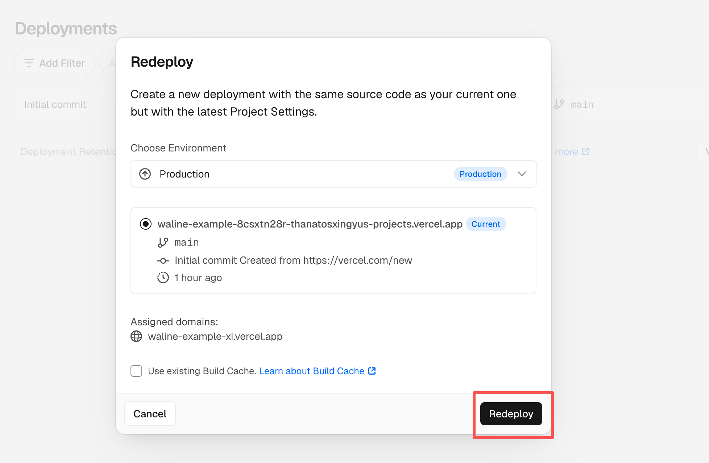

1. 此時會跳轉到 `Overview` 介面開始部署，等待約 1～2 分鐘後 `STATUS` 會變成 `Ready`。此時請點選 `Visit`，即可跳轉到部署好的網站位址，此位址即為你的伺服器位址。

   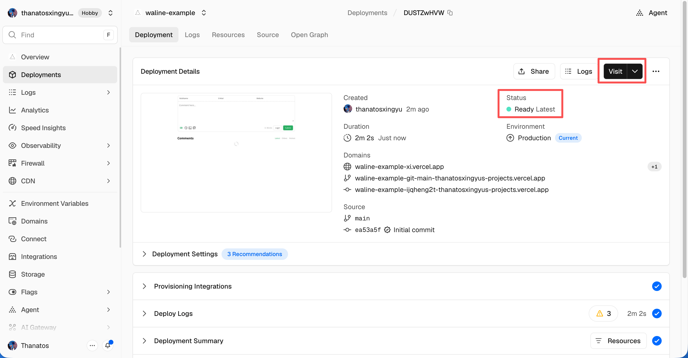

## 綁定網域

1. 點選左側下方的 `Domains` 進入網域設定頁，然後點選 `Edit`。
   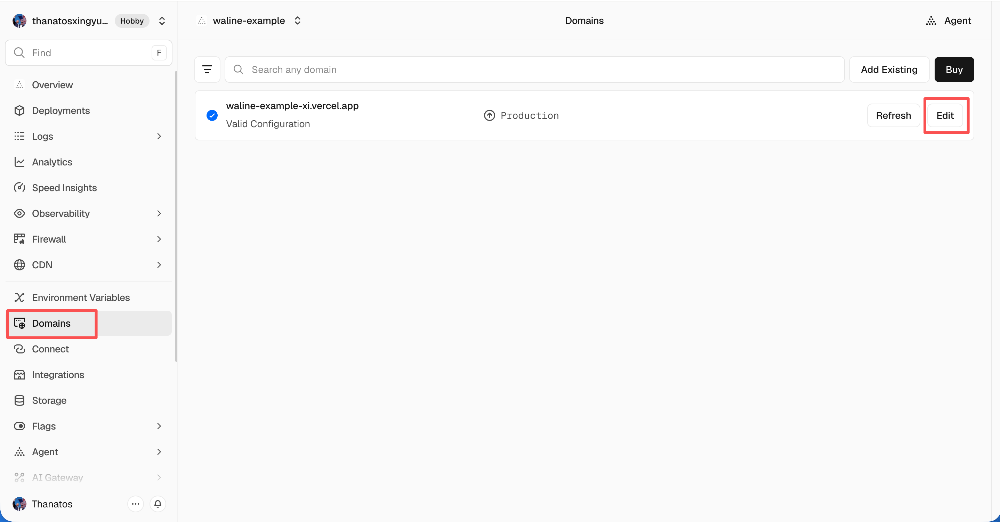
1. 輸入需要綁定的網域並點選 `Save`，以 `example.com` 為例

   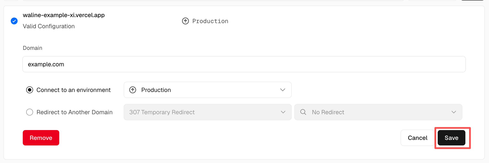

1. 在網域服務商處新增新的 `CNAME` 解析記錄

   | Type  | Name        | Value                |
   | ----- | ----------- | -------------------- |
   | CNAME | example.com | cname.vercel-dns.com |

1. 等待生效，你就可以透過自己的網域來造訪了:tada:
   - 留言系統：example.com
   - 留言管理（後台）：example.com/ui

   ::: note
   綁定完成後，建議儘快造訪後台頁面進行註冊。首個註冊的人會被設定成管理員。
   :::

   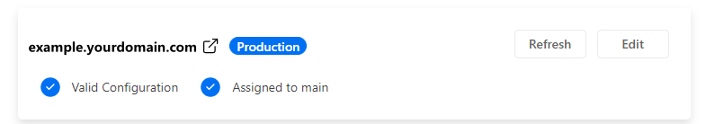

## HTML 引入

在你的網頁中進行如下設定：

1. 匯入 Waline 樣式 `https://unpkg.com/@waline/client@v3/dist/waline.css`。

1. 建立 `<script>` 標籤，使用來自 `https://unpkg.com/@waline/client@v3/dist/waline.js` 的 `init()` 函式初始化，並傳入必要的 `el` 與 `serverURL` 選項。
   - `el` 選項是 Waline 繪製時使用的元素，你可以設定一個字串形式的 CSS 選擇器或者一個 HTMLElement 物件。
   - `serverURL` 是伺服器的位址，即上一步取得的值。

   ```html {3-7,12-18}:line-numbers
   <head>
     <!-- ... -->
     <link rel="stylesheet" href="https://unpkg.com/@waline/client@v3/dist/waline.css" />
     <!-- ... -->
   </head>
   <body>
     <!-- ... -->
     <div id="waline"></div>
     <script type="module">
       import { init } from 'https://unpkg.com/@waline/client@v3/dist/waline.js';

       init({
         el: '#waline',
         serverURL: 'https://your-domain.vercel.app',
       });
     </script>
   </body>
   ```

1. 留言服務此時就會在你的網站上成功運作 :tada:

## 留言管理（管理端）

1. 部署完成後，請造訪 `<serverURL>/ui/register` 進行註冊。首個註冊的人會被設定成管理員。
1. 管理員登入後，即可看到留言管理介面。在這裡可以修改、標記或刪除留言。
1. 使用者也可透過留言框註冊帳號，登入後會跳轉到自己的個人檔案頁。
